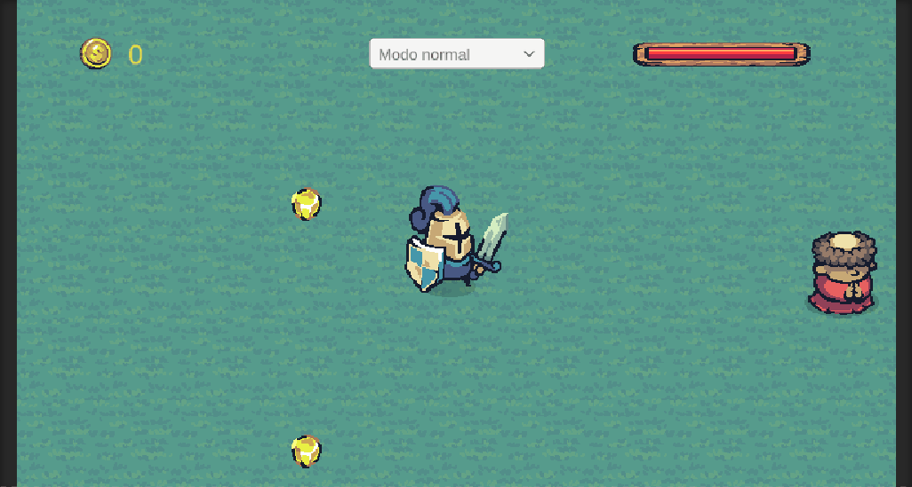
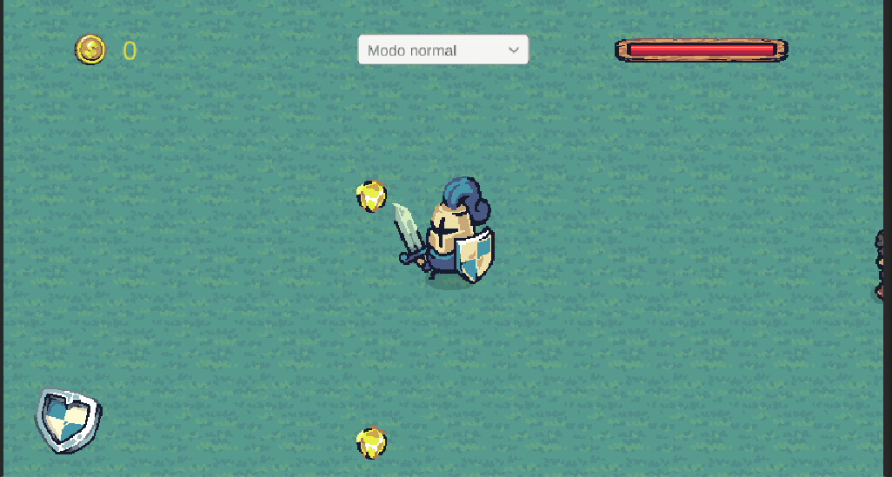
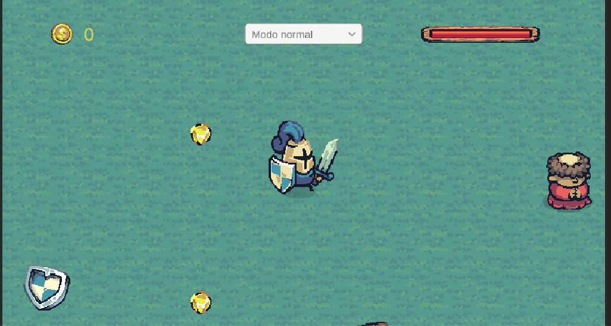

# Eventos

Para realizar esta actividad se ha preparado un mapa utilizando los assets de Tiny Swords - Pixel Frog ([Asset](https://pixelfrog-assets.itch.io/tiny-swords))


Se ha colocado un personaje principal con su funcionalidad de movimiento y animaciones, un enemigo que permanece quieto y menas de oro como coleccionable a obtener.

> Implementar una interfaz de usuario (UI) en Unity 2D que cumpla con los siguientes requisitos: Incluye un botón o selector que permite alternar el modo de movimiento del personaje entre Modo Sigilo (velocidad reducida) y Modo Normal (velocidad estándar). Muestra en pantalla la cantidad de objetos recolectados (ej. monedas o cristales). Si el personaje choca contra un objeto especial o trampa 2D, se debe descontar automáticamente un valor de su barra/texto de resistencia o vida en la UI.

Para empezar, la interfaz se ha preparado utilizando una imagen para el icono de las monedas, un TextMeshPro para el valor del oro, un slider para la barra de vida y un menú dropdown para el cambio de modo de velocidad.

El mapa se ha creado utilizando tiles, excepto para el enemigo, la torre y el personaje principal.

Para las pepitas de oro, se ha creado un tilemap con colisión, y en el script GoldCollector que lleva el personaje principal se ha incluido esta interacción:

```cs 
private void OnTriggerEnter2D(Collider2D other) 
{
    if (other.tag == "Gold")
    {
        Vector2 hit = other.ClosestPoint(transform.position);
        goldTilemap.SetTile(goldTilemap.WorldToCell(hit), null);
        gold += 1;
        UpdateGoldText();
    }
}

private void UpdateGoldText()
{
    goldText.text = gold.ToString();
}
```

De esta manera se incrementa y modifica el oro correspondiente en el HUD.

Para el menú dropdown, se ha establecido la siguiente función y se ha enlazado al evento `OnValueChanged()` dentro del editor de Unity:

```cs
public void ChangeSpeedMode(int mode)
{
    switch (mode)
    {
        case (int)SpeedMode.NORMAL:
        {
            player.speed = 5.0f;
            break;
        }
        case (int)SpeedMode.SILENT:
        {
            player.speed = 2.0f;
            break;
        }
    }
}
```

En el caso de la vida del personaje, el slider lo gestiona principalmente el enemigo (la trampa) que está en el mapa. Idealmente debería gestionarse en otro sistema aparte, pero por simplicidad, se ha colocado la referencia del slider en el script del enemigo. De esta manera, la vida se gestiona como:

```cs
private void OnTriggerEnter2D(Collider2D other)
{
    if (other.tag == "Player")
    {
        animator.SetTrigger("Attack");
        playerHealth.value = Mathf.Clamp01(playerHealth.value - 0.2f); // Reducción de daño
    }
}
```

Con estas tres mejoras, el resultado queda así:



> Agregar un personaje a la escena que, al hacer clic sobre un botón específico de la UI, se dirija progresivamente en el espacio 2D hacia su guarida que estará posicionada en la escena

En este caso, en vez de asignar la función directamente al `OnClick()` del botón, utilizamos un notificador en conjunto de los eventos de Unity.
Para ello, creo un ButtonHandler que tenga la notificación. En el lado del enemigo, se procede a escuchar dicha notificación. Al pulsar el botón, el `onClick` enlazado llama a `NotifyCastleBack()`

```cs
public void NotifyCastleBack()
{
    onCastleBack.Invoke();
}
```

Para mover el personaje se reutiliza código del movimiento rectilíneo. En este caso, lo que se propone es que el objetivo inicial sea el propio enemigo, de manera que no se mueva. Al pulsar el botón, el transform objetivo pasa a ser el del castillo. El resultado se ve de esta manera:



> Agregar a la escena un objeto recolectable que, al colisionar con el jugador, dispare un evento que haga que otros dos objetos en la escena realicen las siguientes acciones simultáneamente:
Objeto A: Comienza a desplazarse de forma fluida hacia la posición actual del jugador.
Objeto B: Se posiciona o traslada de forma inmediata a un punto fijo determinado dentro de la escena.

Para lograr esto, se han colocado tres objetos: un tronco, un filete y una oveja. El filete va a ser el notificador del evento, mientras que el tronco y la oveja escucharán y harán acciones distintas.
Por un lado, la notificación del filete se realiza con un delegado nativo de C#:

```cs
public delegate void MeatEatenDelegate();
public event MeatEatenDelegate OnMeatEaten;

private void OnTriggerEnter2D(Collider2D other) {
    if (other.tag == "Player")
    {
        OnMeatEaten();
        Destroy(gameObject);
    }
}
```

Al evento `OnMeatEaten()` se suscriben tanto la oveja como el tronco:

```cs
meat.OnMeatEaten += FollowPlayer; // En el tronco
meat.OnMeatEaten += RunAway; // En la oveja
```

Como resultado, dos objetos independientes escuchan la misma notificación y actúan con sus propias respuestas:

